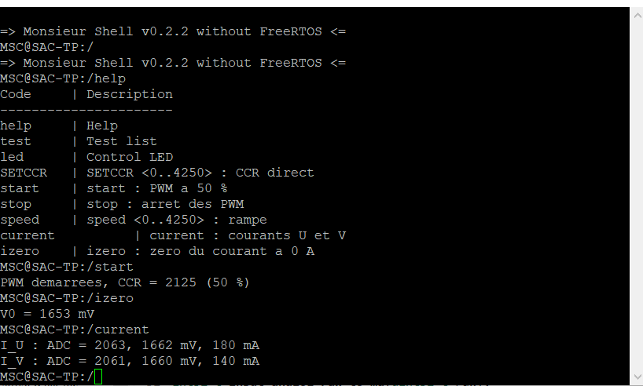
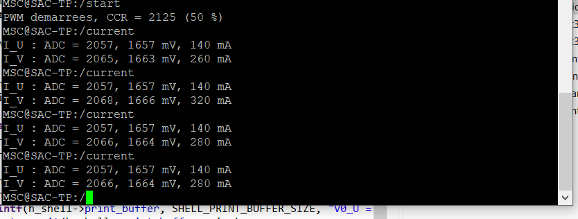

# TP Actionneur et Automatique appliquée — ESE 2026-2027

Commande d'une machine à courant continu (MCC) par un hacheur 4 transistors piloté par une **Nucleo-STM32G474RE**.

| | |
|---|---|
| **Binôme** | Talha FAYYAZ — Iprahim TURGUT |
| **Enseignant** | alexis.martin@ensea.fr |
| **Avancement** | §1 → §7.1 terminés · §7.2 en cours (mesure en polling) · §7.3 à faire |

---

## Sommaire
1. [Organisation du dépôt](#1-organisation-du-dépôt)
2. [Mise en place du projet](#2-mise-en-place-du-projet)
3. [Architecture logicielle](#3-architecture-logicielle)
4. [Shell](#4-shell)
5. [6.1 Génération de 4 PWM](#5-61-génération-de-4-pwm)
6. [6.2 Commande de vitesse](#6-62-commande-de-vitesse)
7. [6.3 Premiers tests moteur](#7-63-premiers-tests-moteur)
8. [7.1 Commande de la vitesse avec rampe](#8-71-commande-de-la-vitesse-avec-rampe)
9. [7.2 Mesure de courant](#9-72-mesure-de-courant)

---

## 1. Organisation du dépôt

```
.
├── README.md                  ← compte-rendu
├── Images/                    ← captures oscilloscope et terminal
├── PDFs/                      ← sujet du TP, datasheet IRF540N
├── TD/                        ← projets des TD
└── TP/
    ├── hardware/Inverter_KiCAD   ← schéma du hacheur
    └── software/Base             ← projet STM32CubeIDE du TP
        └── Core/Src
            ├── acquisition/      input_analog, input_encoder
            ├── motor_control/    motor (PWM), asserv (PID)
            ├── user_interface/   button, led, shell
            └── app.c             init_device() + loop()
```

## 2. Mise en place du projet

- Projet de base récupéré depuis le dépôt de l'enseignant (`DBXYD/2526_MSC_SAC`, dossier `TP/`).
- Projet ouvert dans STM32CubeIDE depuis `TP/software/Base`.
- **Correction de la base** : `led_init()` était appelée dans `app.c` sans prototype, ce qui provoque une erreur *implicit declaration* avec les compilateurs récents. Le prototype a été ajouté dans `led.h` et `led.h` est inclus dans `app.c`.

## 3. Architecture logicielle

- `main.c` initialise les périphériques générés par CubeMX, appelle `init_device()` une fois, puis `loop()` en boucle.
- `init_device()` (dans `app.c`) initialise :
  1. le **shell** sur l'UART2 (réception d'un caractère par interruption) ;
  2. la **LED** (commande `led`) ;
  3. le **moteur** avec `motor_init()`.
- `HAL_UART_RxCpltCallback` relance la réception puis appelle `shell_run()` : le shell tourne en tâche de fond.
- L'UART2 n'est utilisée que dans `app.c`, ce qui rend les autres modules portables.

## 4. Shell

Terminal série via l'USB ST-Link (Tera Term, port COM de la Nucleo).

| Commande | Rôle |
|---|---|
| `help` | Liste des commandes |
| `test a b c` | Affiche les arguments reçus |
| `led on/off/toggle` | Pilote la LED utilisateur |
| `SETCCR XXXX` | Fixe le rapport cyclique immédiatement (voir §6.2) |
| `start` | Démarre les PWM à 50 % (voir §7.1) |
| `stop` | Arrête les PWM (voir §7.1) |
| `speed XXXX` | Atteint le CCR demandé avec une rampe (voir §7.1) |
| `current` | Affiche les courants des bras U et V (voir §7.2) |
| `izero` | Enregistre le zéro des capteurs de courant (voir §7.2) |

Pour ajouter une commande, on écrit une fonction `int f(h_shell_t*, int argc, char** argv)` puis on l'enregistre avec `shell_add(&hshell1, "nom", f, "description")`.

---

## 5. 6.1 Génération de 4 PWM

### Cahier des charges
| Exigence | Demandé | Obtenu |
|---|---|---|
| Fréquence PWM | 20 kHz | **20,01 kHz** (mesuré) |
| Résolution | ≥ 10 bits | **≈ 12 bits** |
| Temps mort | selon la datasheet des transistors | **118 ns** (DTG = 20), mesuré 122–124 ns |
| Rapport cyclique de test | 60 % | CCR_U = 2550 |

### Broches utilisées (TIM1, déjà attribué)
| Bras | Transistor haut | Transistor bas |
|---|---|---|
| U | TIM1_CH1 → **PA8** | TIM1_CH1N → **PB13** |
| V | TIM1_CH2 → **PA9** | TIM1_CH2N → **PB14** |

### Commande complémentaire décalée
- Bras U : rapport cyclique **α**, bras V : rapport cyclique **1 − α**, soit `CCR_V = PWM_PERIOD − CCR_U`.
- Tension moyenne aux bornes du moteur : **⟨U⟩ = (2α − 1)·V_bus**, d'où :
  - α = 50 % → tension moyenne nulle, moteur à l'arrêt ;
  - α > 50 % → un sens de rotation ;
  - α < 50 % → l'autre sens.
- Le timer est en mode **center-aligned** : les impulsions des bras U et V sont centrées sur le même instant, et le moteur voit une tension découpée à 2 × 20 kHz.

### Fréquence et résolution
- Horloge timer : HSE 24 MHz → PLL → **f_TIM = 170 MHz**, Prescaler = 0.
- En center-aligned, le compteur monte puis redescend (0 → ARR → 0), donc **une période = 2 × ARR ticks**.

  f_PWM = 170 MHz / (2 × ARR), soit ARR ≈ 4250 pour 20 kHz.

- Valeur configurée : **ARR = 4250 − 1 = 4249**, ce qui donne f = 170 MHz / (2 × 4249) = 20,005 kHz. L'oscilloscope mesure **20,01 kHz**.
- Résolution : log₂(4249) ≈ **12 bits** ≥ 10 bits.

### Temps mort
Transistors du hacheur : **IRF540N** (datasheet dans `PDFs/`).

| Paramètre (datasheet) | Valeur |
|---|---|
| t_d(on) — Turn-On Delay Time | 9,5 ns |
| t_d(off) — Turn-Off Delay Time | 40 ns |
| t_f — Fall Time | 55 ns |

Le temps mort doit couvrir le blocage du transistor qui s'éteint, moins le délai d'allumage de l'autre :

**DT_min = t_d(off) + t_f − t_d(on) = 40 + 55 − 9,5 ≈ 86 ns**

Programmation : 1 pas de DTG = 1 / 170 MHz = 5,88 ns.
Valeur choisie : **DTG = 20, soit 20 × 5,88 = 118 ns**, ce qui laisse environ 30 ns de marge.

> Remarque : les grilles sont commandées par un driver opto-isolé HCPL-315J (un par bras, double voie). Sa datasheet donne un écart de propagation entre voies (PDD) de ±350 ns. Si l'enseignant le demande, le temps mort pourra être augmenté jusqu'à environ 500 ns (DTG = 85) pour couvrir cet écart.

### Configuration CubeMX de TIM1
| Paramètre | Valeur |
|---|---|
| Channel 1 / Channel 2 | PWM Generation CH1 CH1N / CH2 CH2N |
| Prescaler | 0 |
| Counter Mode | Center Aligned mode 1 |
| Counter Period | 4250 − 1 |
| Dead Time | 20 |
| Pulse CH1 / CH2 | 2550 / 1700 (60 % / 40 %) |

### Code (`motor_control/motor.c`)
```c
void motor_init(void)
{
	shell_add(&hshell1, "SETCCR", sh_set_ccr, "SETCCR <0..4250> : rapport cyclique");
	motor_set_ccr(PWM_DUTY_TEST);                      // 60 %

	if (HAL_TIM_PWM_Start(&htim1, TIM_CHANNEL_1) != HAL_OK)    Error_Handler();
	if (HAL_TIMEx_PWMN_Start(&htim1, TIM_CHANNEL_1) != HAL_OK) Error_Handler();
	if (HAL_TIM_PWM_Start(&htim1, TIM_CHANNEL_2) != HAL_OK)    Error_Handler();
	if (HAL_TIMEx_PWMN_Start(&htim1, TIM_CHANNEL_2) != HAL_OK) Error_Handler();
}
```

### Validation à l'oscilloscope

**4 PWM avec la sonde numérique** (D0 = PA8, D1 = PB13, D2 = PA9, D3 = PB14, seuil 1,65 V, 40 µs/div) :


- Les signaux haut et bas de chaque bras sont **complémentaires**.
- Les impulsions des bras U et V sont **centrées sur le même instant** : c'est la commande décalée.

**Temps mort, bras U** (PA8 ↓ → PB13 ↑, 200 ns/div) : **Δt = 124 ns**


**Temps mort, bras V** (PA9 ↓ → PB14 ↑, 100 ns/div) : **Δt = 122 ns**


**Deux voies complémentaires** (voies analogiques, CCR = 2000) : **f = 20,01 kHz**


| Mesure | Attendu | Mesuré |
|---|---|---|
| Fréquence | 20 kHz (20,005 kHz avec ARR = 4249) | **20,01 kHz** |
| Complémentarité haut / bas | oui | oui |
| Commande décalée (U et V centrés) | oui | oui |
| Temps mort bras U (PA8 → PB13) | 118 ns | **124 ns** |
| Temps mort bras V (PA9 → PB14) | 118 ns | **122 ns** |

L'écart de 4 à 6 ns sur le temps mort vient du temps de montée des sorties GPIO (configurées en vitesse *Low*) et de la résolution de la sonde numérique (2 ns).

---

## 6. 6.2 Commande de vitesse

### Principe
La commande `SETCCR XXXX`, envoyée par l'UART (USB), fixe le rapport cyclique :

1. **Détection de la commande** : le shell compare le premier mot reçu aux commandes enregistrées avec `shell_add`.
2. **Conversion** : `strtol` transforme `XXXX` en entier. La valeur est refusée si elle contient autre chose que des chiffres ou si elle est négative.
3. **Vérification** : la valeur doit être comprise entre **`PWM_CCR_MIN` = 0 et `PWM_CCR_MAX` = 4250 (α = 100 %)**. Si elle est hors plage, un **message d'erreur** est affiché et **rien n'est modifié**.
4. **Application** : `motor_set_ccr()` écrit `CCR_U = ccr` et `CCR_V = PWM_PERIOD − ccr`, ce qui pilote les 4 transistors.

> **Choix de sécurité :** le sujet propose de ramener une valeur trop grande au maximum. Nous avons choisi de **refuser** la valeur à la place : une faute de frappe (par exemple 30000 au lieu de 3000) ne peut ainsi pas envoyer le moteur à pleine vitesse.
>
> Le nom `SETCCR` est utilisé à la place de `SET_CCR`, car le shell de base refuse le caractère `_` (fonction `is_character_valid` dans `shell.c`).

### Code
```c
#define PWM_PERIOD      4250                    // ARR + 1
#define PWM_CCR_MAX     PWM_PERIOD              // alpha = 100 %
#define PWM_CCR_MIN     0                       // alpha = 0 %
#define PWM_CCR_STOP    (PWM_PERIOD / 2)        // alpha = 50 % -> tension moyenne nulle
#define PWM_DUTY_TEST   2550                    // 60 %

HAL_StatusTypeDef motor_set_ccr(uint32_t ccr)
{
	if (ccr > PWM_CCR_MAX) {
		return HAL_ERROR;                       // hors plage : on ne touche à rien
	}
	__HAL_TIM_SET_COMPARE(&htim1, TIM_CHANNEL_1, ccr);
	__HAL_TIM_SET_COMPARE(&htim1, TIM_CHANNEL_2, PWM_PERIOD - ccr);
	return HAL_OK;
}

int sh_set_ccr(h_shell_t * h_shell, int argc, char ** argv)
{
	int size;

	if (argc != 2) {
		size = snprintf(h_shell->print_buffer, SHELL_PRINT_BUFFER_SIZE, "Usage : SETCCR <%d..%d>\r\n", PWM_CCR_MIN, PWM_CCR_MAX);
		h_shell->drv.transmit(h_shell->print_buffer, size);
		return -1;
	}

	char * end;
	long value = strtol(argv[1], &end, 10);     // conversion chaîne -> entier

	if (*end != '\0' || value < PWM_CCR_MIN || value > PWM_CCR_MAX) {
		size = snprintf(h_shell->print_buffer, SHELL_PRINT_BUFFER_SIZE, "Erreur : valeur hors plage <%d..%d>, rien n'est modifie\r\n", PWM_CCR_MIN, PWM_CCR_MAX);
		h_shell->drv.transmit(h_shell->print_buffer, size);
		return -1;
	}

	motor_set_ccr((uint32_t)value);
	size = snprintf(h_shell->print_buffer, SHELL_PRINT_BUFFER_SIZE, "CCR = %ld\r\n", value);
	h_shell->drv.transmit(h_shell->print_buffer, size);
	return 0;
}
```

### Tests
**Premiers essais** (Tera Term), avec la première version de la commande :


**Version finale** (PuTTY), avec confirmation et gestion des erreurs :


| Commande tapée | Réponse du shell | Ce qui est vérifié |
|---|---|---|
| `SETCCR 2125` | `CCR = 2125` | valeur valide appliquée (α = 50 %) |
| `SETCCR 5000` | `Erreur : valeur hors plage <0..4250>, rien n'est modifie` | valeur > max **refusée** |
| `SET` | `SET : no such command` | seule la commande exacte est reconnue |
| `SETCCR2400` | `SETCCR2400 : no such command` | un espace est obligatoire entre la commande et la valeur |
| `SETCCR 2400` | `CCR = 2400` | valeur valide appliquée |

Le rapport cyclique mesuré sur le bras U suit bien la commande :

| Commande | α théorique (CCR / 4249) | α mesuré |
|---|---|---|
| `SETCCR 1000` | 23,5 % | **23,28 %** |
| `SETCCR 2000` | 47,1 % | voies complémentaires à 20,01 kHz (§6.1) |
| `SETCCR 3000` | 70,6 % | **70,35 %** |

L'écart d'environ 0,2 % correspond au temps mort : 118 ns / 50 µs ≈ 0,24 %.

| CCR = 1000 | CCR = 3000 |
|---|---|
|  |  |

---

## 7. 6.3 Premiers tests moteur

### Protocole
1. Moteur branché en respectant ses données constructeur, signaux vérifiés par l'enseignant.
2. Démarrage à **α = 50 %** (`SETCCR 2125`) : tension moyenne nulle, le moteur reste à l'arrêt.
3. Passage à **α = 70 %** (`SETCCR 2975`).

### Essai à CCR = 2500 (α ≈ 59 %)


- **D0 à D3** : les 4 PWM restent complémentaires et décalées, moteur branché.
- **Voie 1 (jaune, 20 V/div)** : tension côté puissance pendant la rotation du moteur. On observe des **surtensions et des oscillations à chaque commutation**, dues aux inductances du moteur et du câblage.

### Problème d'un changement brutal de rapport cyclique
Un passage brutal du rapport cyclique (par exemple de 50 % à 70 %) applique d'un coup une forte tension moyenne au moteur, alors qu'il est encore à l'arrêt. Sa force contre-électromotrice est nulle, donc le courant n'est limité que par la résistance de l'induit : c'est un **fort appel de courant**, qui peut déclencher les protections du hacheur et provoquer un à-coup mécanique.

### Solution
Il faut une **montée progressive du rapport cyclique** jusqu'à la valeur demandée, avec un petit incrément du CCR à intervalle de temps régulier. Cette rampe est mise en place avec la commande `speed` au §7.1.

---

## 8. 7.1 Commande de la vitesse avec rampe

### Objectif
Ne plus appliquer la consigne d'un coup comme avec `SETCCR`, mais **limiter l'accélération** pour éviter l'appel de courant observé en 6.3.

### Commandes ajoutées
| Commande | Rôle |
|---|---|
| `start` | Fixe le CCR à 2125 (α = 50 %, vitesse nulle) puis démarre les 4 PWM (`HAL_TIM_PWM_Start` et `HAL_TIMEx_PWMN_Start`) |
| `stop` | Arrête les 4 PWM (`HAL_TIM_PWM_Stop` et `HAL_TIMEx_PWMN_Stop`) et remet le CCR à 2125 |
| `speed XXXX` | Définit une **cible** de CCR (0 à 4250). Le CCR rejoint cette cible progressivement. |

**Sécurité :**
- Les PWM ne démarrent plus automatiquement au reset : il faut taper `start`.
- `speed` est refusé tant que le moteur n'a pas été démarré.
- Une valeur hors de [0 ; 4250] est refusée, et rien n'est modifié.

### Principe de la rampe
Le programme conserve deux valeurs :
- `ccr_current` : le CCR appliqué actuellement dans TIM1 ;
- `ccr_target` : le CCR demandé par `speed`.

La commande `speed` ne modifie que la **cible**. La fonction `motor_ramp_update()`, appelée en permanence dans `loop()`, rapproche le CCR actuel de la cible de **`RAMP_STEP` = 5 pas toutes les `RAMP_PERIOD_MS` = 10 ms** (temporisation non bloquante avec `HAL_GetTick()`).

| Transition | Écart de CCR | Durée de la rampe |
|---|---|---|
| 50 % → 70 % (2125 → 2975) | 850 | 850 / 5 × 10 ms = **1,7 s** |
| 50 % → 100 % (2125 → 4250) | 2125 | **4,25 s** |

La pente se règle en modifiant uniquement `RAMP_STEP` et `RAMP_PERIOD_MS` dans `motor.h`.

### Code
**`motor.h`**
```c
#define RAMP_STEP           5                   // pas de CCR
#define RAMP_PERIOD_MS      10                  // ms entre deux pas

void motor_ramp_update(void);
int sh_start(h_shell_t * h_shell, int argc, char ** argv);
int sh_stop(h_shell_t * h_shell, int argc, char ** argv);
int sh_speed(h_shell_t * h_shell, int argc, char ** argv);
```

**`motor.c`** : la rampe
```c
static uint32_t ccr_current = PWM_CCR_STOP;              // CCR appliqué actuellement
static volatile uint32_t ccr_target = PWM_CCR_STOP;      // CCR visé (modifié par le shell)
static volatile uint8_t motor_running = 0;               // 1 si les PWM sont actives

void motor_ramp_update(void)
{
	static uint32_t last_tick = 0;
	uint32_t target = ccr_target;

	if (!motor_running || ccr_current == target)
	{
		return;
	}
	if (HAL_GetTick() - last_tick < RAMP_PERIOD_MS)
	{
		return;
	}
	last_tick = HAL_GetTick();

	if (ccr_current < target)
	{
		motor_apply_ccr((target - ccr_current > RAMP_STEP) ? ccr_current + RAMP_STEP : target);
	}
	else
	{
		motor_apply_ccr((ccr_current - target > RAMP_STEP) ? ccr_current - RAMP_STEP : target);
	}
}
```

**`app.c`**
```c
void loop(){
	motor_ramp_update();
}
```

### Tests
| Commande | Réponse du shell | Comportement observé |
|---|---|---|
| *(reset)* | — | aucune PWM |
| `speed 3000` | `Erreur : moteur arrete, taper start` | rien ne change |
| `start` | `PWM demarrees, CCR = 2125 (50 %)` | 4 PWM à 50 %, moteur à l'arrêt |
| `speed 2975` | `Rampe vers CCR = 2975` | le moteur accélère **progressivement** jusqu'à α = 70 % |
| `speed 2125` | `Rampe vers CCR = 2125` | décélération progressive jusqu'à l'arrêt |
| `speed 1275` | `Rampe vers CCR = 1275` | accélération progressive **dans l'autre sens** (α = 30 %) |
| `speed 5000` | `Erreur : speed <0..4250>, rien n'est modifie` | rien ne change |
| `stop` | `PWM arretees` | PWM coupées |

Le moteur démarre et change de sens **sans à-coup** : la rampe supprime le problème d'appel de courant observé en 6.3.

---

## 9. 7.2 Mesure de courant

### Courants à mesurer
Le moteur est branché entre les bras U et V : **le courant du bras U est le courant du moteur**. Le bras V est traversé par le même courant, de signe opposé (I_V = −I_U), ce qui sert de vérification.

Chaque bras possède un capteur de courant à effet Hall **LEM GO 10-SME/SP3** (U204 pour U, U304 pour V sur le schéma KiCad). Le courant de sortie du bras traverse le capteur avant d'aller vers le moteur.

| Capteur | Courant mesuré | Signal | Broche STM32 | Voie ADC |
|---|---|---|---|---|
| U204 | I_U (courant moteur) | `U_Imes` | **PA1** | ADC1_IN2 |
| U304 | I_V = −I_U | `V_Imes` | **PB1** | ADC1_IN12 |

### Fonction de transfert du capteur
Valeurs relevées dans la datasheet GO-SME/SP3 (tableau *Electrical data*, page 4) :

| Paramètre | Valeur |
|---|---|
| Alimentation U_C | 3,3 V |
| Tension de sortie à 0 A (V_ref) | 1,65 V (± 5 mV d'offset) |
| Sensibilité G | **50 mV/A** |
| Plage de mesure | −25 A à +25 A, soit une sortie de 0,40 V à 2,90 V |

**V_out = 1,65 V + 0,050 × I, donc I = (V_out − V₀) / G**

Chaîne de mesure complète, avec un ADC 12 bits et une référence de 3,3 V :

**V = ADC × 3300 / 4096 (mV) et I = (V − V₀) × 1000 / 50 (mA)**

- Toute la plage du capteur (0,40 à 2,90 V) reste dans la plage de l'ADC (0 à 3,3 V).
- Résolution : 3,3 V / 4096 = 0,8 mV, soit environ **16 mA par pas d'ADC**.

### Première mesure en polling
Le module `acquisition/input_analog.c` réalise la mesure à la demande :
1. `input_analog_read_raw()` choisit la voie, lance une conversion (`HAL_ADC_Start`), **attend** la fin (`HAL_ADC_PollForConversion`) puis lit le résultat (`HAL_ADC_GetValue`). Il n'y a rien à modifier dans CubeMX : la voie est choisie par le code avant chaque conversion.
2. `input_analog_read_avg()` fait la **moyenne de 64 mesures** (environ 1 ms, soit une vingtaine de périodes de PWM) pour lisser l'ondulation de courant due au découpage.
3. La commande `izero`, lancée **moteur à l'arrêt**, mesure la tension réelle de chaque capteur à 0 A et l'enregistre comme V₀. Elle corrige ainsi l'offset propre à chaque capteur.
4. La commande `current` affiche, pour chaque bras, la valeur ADC brute, la tension en mV et le courant en mA.

```c
/* Valeur ADC -> courant (mA) : I = (V - V0) / G */
int32_t input_analog_raw_to_ma(uint32_t raw, int32_t v0_mv)
{
	return (input_analog_raw_to_mv(raw) - v0_mv) * 1000 / CURRENT_SENSITIVITY_MV_PER_A;
}
```

### Tests

**Première version** (une seule mesure par commande, et `izero` ne calibrait que le capteur U) :



| Capteur | ADC | Tension | Courant affiché |
|---|---|---|---|
| U | 2063 | 1662 mV | 180 mA |
| V | 2061 | 1660 mV | 140 mA |

Après `izero` (V₀ = 1653 mV), le courant à vitesse nulle aurait dû être proche de 0. Deux défauts expliquent l'écart :
- **Une seule mesure, prise à un instant quelconque** : même à α = 50 %, le courant ondule à chaque commutation autour d'une moyenne nulle. Une mesure isolée peut tomber sur une crête de cette ondulation (9 mV d'écart, soit seulement 11 pas d'ADC).
- **Un seul V₀ pour les deux capteurs** : I_V était calculé avec le zéro du capteur U, alors que chaque capteur a son propre offset.

Le code a donc été amélioré : **moyenne sur 64 mesures** et **un V₀ par capteur**.

**Version améliorée, vitesse nulle** (`start`, α = 50 %), avec la valeur théorique V₀ = 1650 mV :



| Capteur | ADC | Tension | Courant affiché |
|---|---|---|---|
| U | 2057 | 1657 mV | 140 mA |
| V | 2065 à 2068 | 1663 à 1666 mV | 260 à 320 mA |

- Grâce à la moyenne sur 64 mesures, la valeur de I_U est **parfaitement stable** d'une mesure à l'autre.
- À vitesse nulle, le courant moyen doit être nul. Les valeurs affichées correspondent à l'**offset de chaque capteur** : environ 7 mV pour U et 14 mV pour V par rapport aux 1,65 V théoriques. Ces offsets sont supprimés en lançant `izero` moteur arrêté.

| Test | Commande | I_U (mA) | I_V (mA) | Attendu |
|---|---|---|---|---|
| Vitesse nulle, après `izero` | `start`, `izero`, `current` | *à compléter* | *à compléter* | ≈ 0 |
| À vide, sens 1 | `speed 2975` | *à compléter* | *à compléter* | faible courant, I_V ≈ −I_U |
| À vide, sens 2 | `speed 1275` | *à compléter* | *à compléter* | signe inversé |
| En charge | `speed 2975` + charge sur la machine synchrone | *à compléter* | *à compléter* | courant plus élevé |

### Prochaine étape
Remplacer la mesure en polling par une chaîne d'acquisition **TIM1 → ADC → DMA**, synchronisée sur la PWM, et vérifier la synchronisation avec un GPIO qui bascule à chaque mesure.
